# Lab 04 – EDR, chasse et réponse avec Microsoft Defender for Endpoint et Defender XDR

> **English summary:** Endpoint detection and response lab on the honeypot VM from Labs 01–03. I enabled **Microsoft Defender for Servers Plan 2** (30-day trial), which onboarded the VM to **Microsoft Defender for Endpoint (MDE)**. I ran a safe detection test and investigated the resulting behavioural alert end to end (process tree, device timeline, MITRE mapping), then went further: I simulated a **Discovery** technique set over RDP, hunted the activity in **KQL (Advanced Hunting)**, and turned the query into a **custom detection rule** that automatically generated a case. I also configured **Just-in-Time (JIT)** access, reviewed the VM's **22 vulnerabilities (MDVM)** and their single remediation, and exercised the **device isolation / release** response cycle with its audit trail. This lab moves from *posture* (Lab 03, CSPM) to *protection* (CWP).

## Résultats en bref
| Mesure | Valeur |
|---|---|
| VM intégrée à Defender for Endpoint | Oui (capteur **Active**) |
| Alerte EDR analysée (test de détection) | 1, comportementale, enquête complète |
| Règle de détection **personnalisée** créée | 1 (rafale de commandes de découverte) → cas généré automatiquement |
| Vulnérabilités découvertes (MDVM) | **22 CVE**, toutes sur un seul composant (OpenSSL) → 1 correction |
| Accès JIT | Configuré (3389/TCP, 1 h, par demande) et testé |
| Cycle de réponse testé | Isolation + libération, tracées dans l'Action center |
| Coût | 0 $ (essai de 30 jours) |

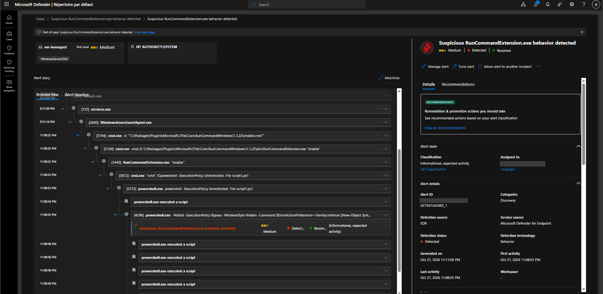

## Contexte : de la posture à la protection
Defender for Cloud a deux piliers :
- **CSPM** (*Cloud Security Posture Management*) — *est-ce bien configuré ?* — le **lab 03** ;
- **CWP** (*Cloud Workload Protection*) — *est-ce attaqué, et comment je réagis ?* — **ce lab**.

Activer **Defender for Servers** bascule sur le volet CWP. C'est un **forfait** payant de Defender for Cloud ; il inclut la licence de **Defender for Endpoint (MDE)**, l'EDR, plus des fonctions cloud : évaluation des vulnérabilités, analyse sans agent, accès JIT.

| Sigle | Sens |
|---|---|
| EPP | Antivirus : bloque les menaces connues |
| **EDR** | Détecte et répond sur les terminaux (comportement) |
| XDR | Corrèle terminaux + identités + courriels + cloud |
| SIEM | Centralise toutes les sources, Microsoft ou non (Sentinel) |

## Environnement
| Élément | Valeur |
|---|---|
| Machine | vm-honeypot (Windows Server 2022, le pot de miel des labs 1-3) |
| Plan activé | Defender for Servers **Plan 2** (essai 30 jours), composants : EDR, évaluation des vulnérabilités, analyse sans agent |
| Portail | Microsoft Defender (security.microsoft.com) |
| Coût | 0 $ pendant l'essai ; plan désactivé à la fin |

## Outils et technologies
Microsoft Defender for Servers · Microsoft Defender for Endpoint (MDE) · Microsoft Defender XDR · Defender Vulnerability Management (MDVM) · Advanced Hunting (KQL) · Azure Run Command · Just-in-Time VM access · MITRE ATT&CK

## 1. Activer Defender for Servers et intégrer la VM
Avant d'activer quoi que ce soit, j'ai vérifié le **prix et l'essai gratuit** (règle du lab : ne jamais activer un plan payant sans le vérifier). Le Plan 2 est à ~15 $/serveur/mois, avec un essai de 30 jours.

| Avant | Composants | Après |
|---|---|---|
| 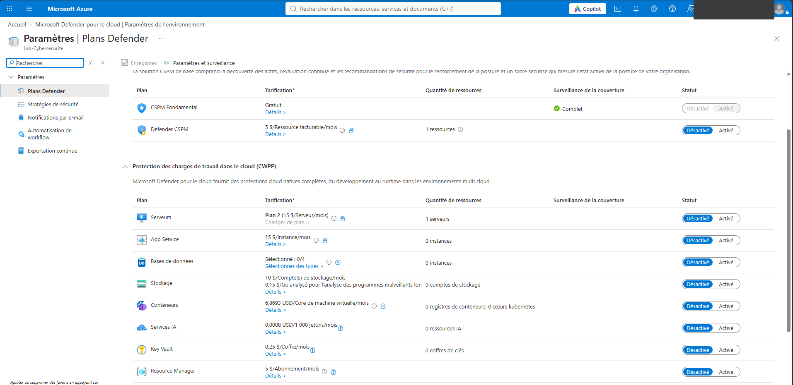 | 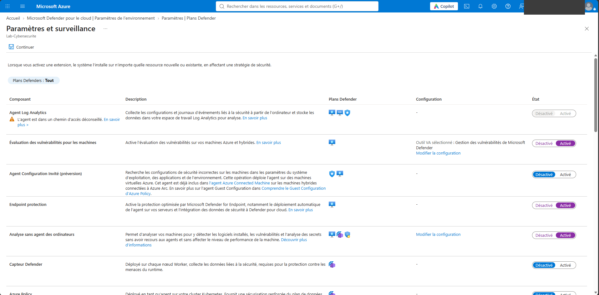 | 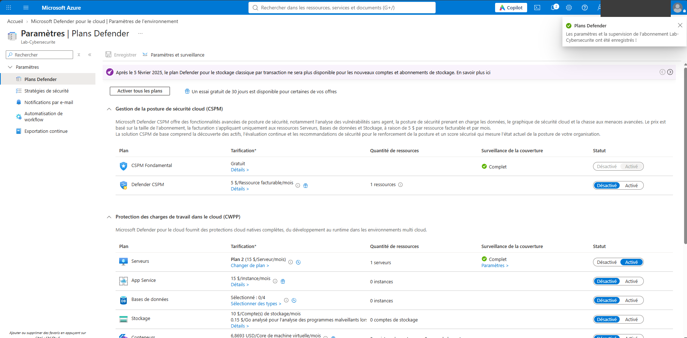 |

L'activation installe automatiquement l'extension **MDE.Windows** (Defender for Endpoint) sur la VM, qui apparaît ensuite comme **appareil intégré** (*Onboarded*) avec un capteur **Active** dans le portail Defender.

| Extension installée | Appareil intégré |
|---|---|
| 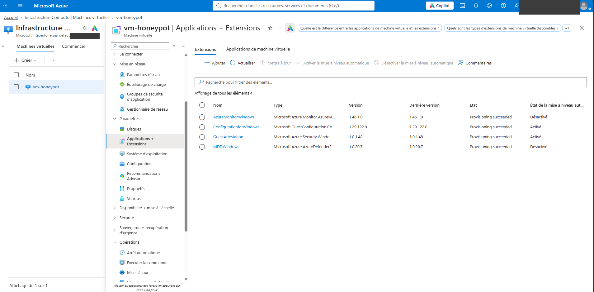 | 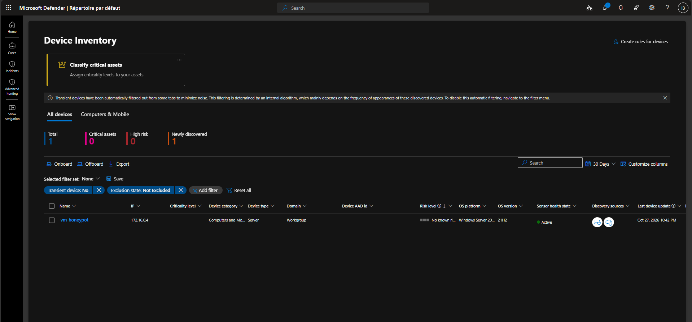 |

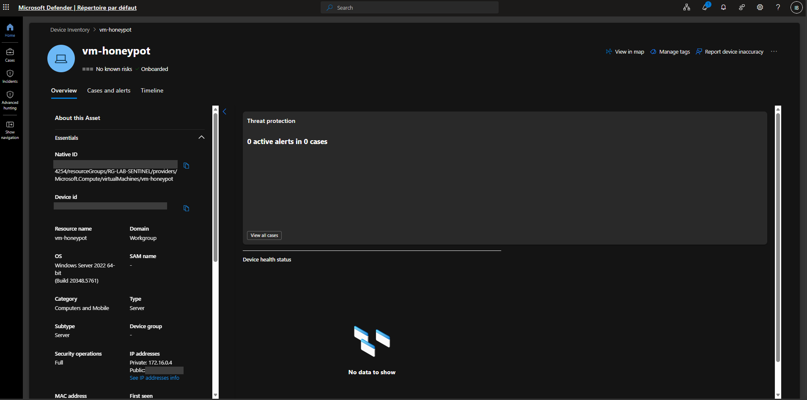

## 2. Test de détection et enquête
Microsoft fournit une commande **inoffensive** qui imite un comportement malveillant (PowerShell caché qui « télécharge » un exécutable vers `127.0.0.1` — rien n'est réellement téléchargé). Je l'ai lancée via **Run Command**, sans ouvrir RDP.

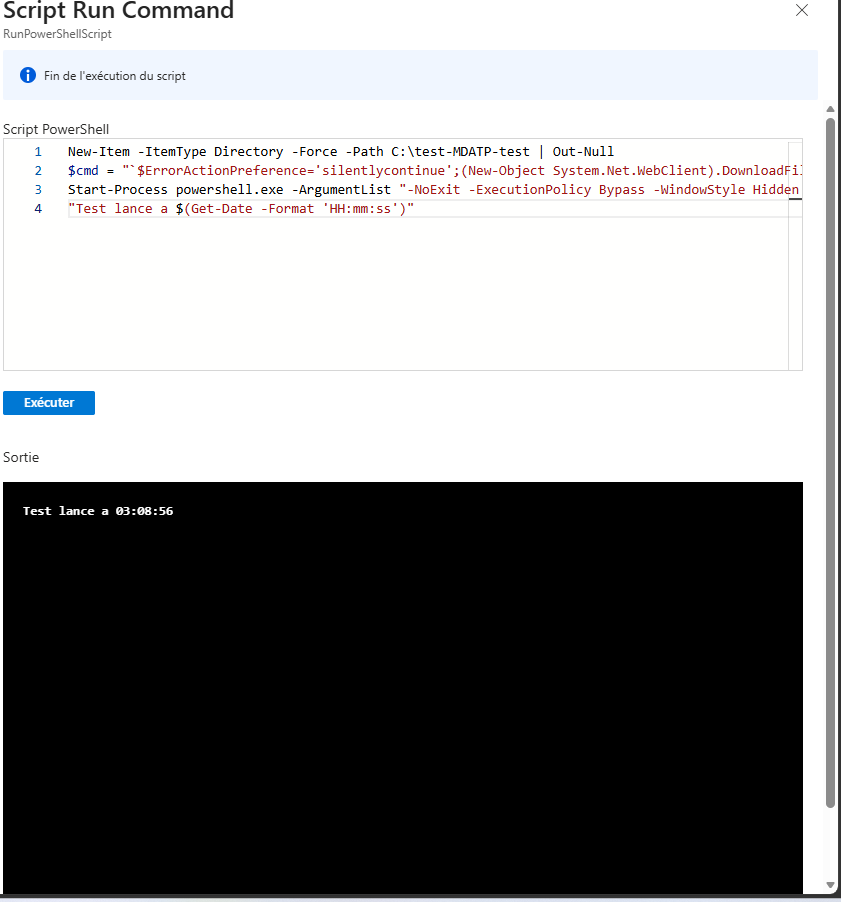

**La télémétrie ≠ l'alerte.** L'EDR enregistre *tout* dans la chronologie (Timeline) de l'appareil : création du fichier, tentative de connexion, suppression. Il associe déjà ces actions à **MITRE ATT&CK** (T1059.001 PowerShell, T1197 BITS Jobs, T1070.004 suppression de fichier).

| Chronologie (Timeline) | Événement + arbre de processus |
|---|---|
| 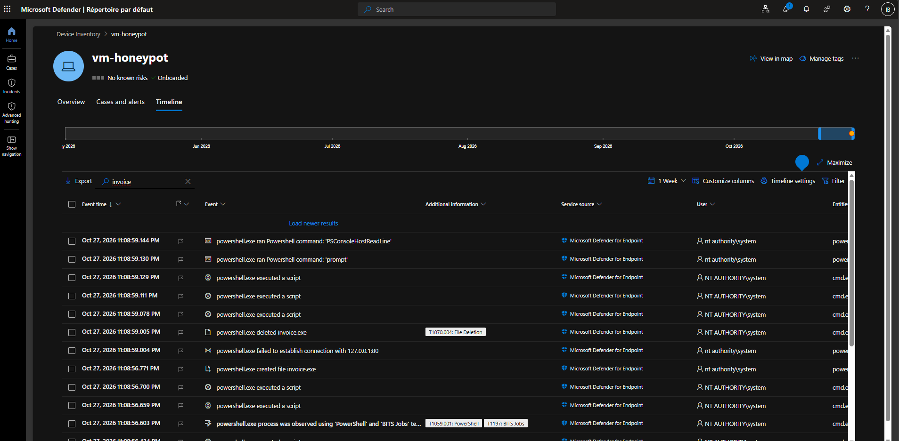 | 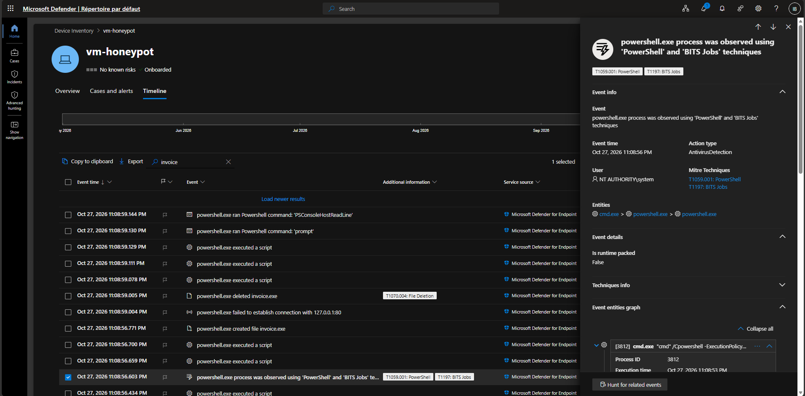 |

Defender a généré une **alerte comportementale** (*Detection technology: Behavior*) : **« Suspicious RunCommandExtension.exe behavior detected »**. Point intéressant : l'EDR a reconnu que l'attaque venait d'un **Run Command Azure** lançant un PowerShell caché — exactement le risque identifié au lab 3 à propos de Run Command.

| Alerte | Détails | Recommandations |
|---|---|---|
| 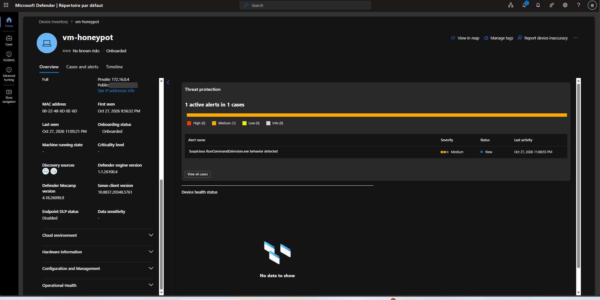 | 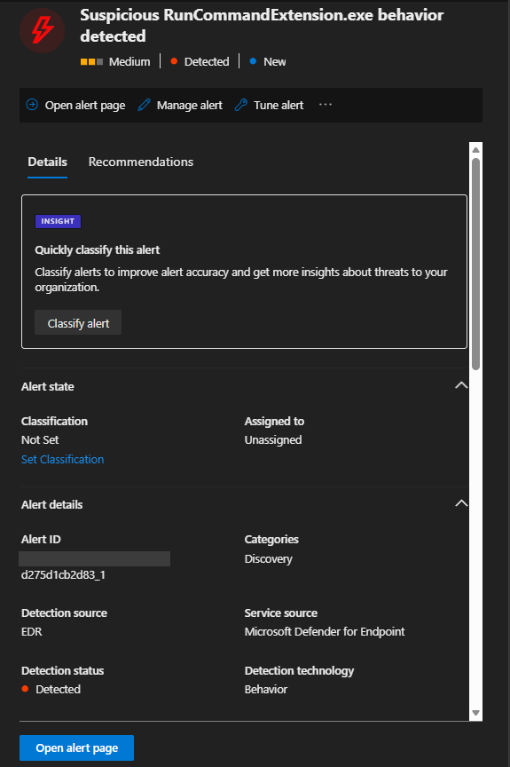 | 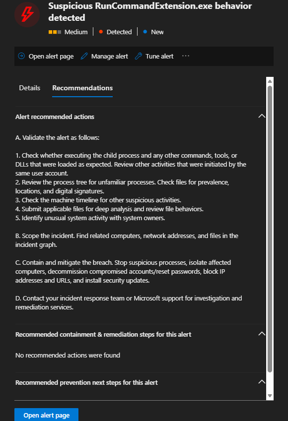 |

**Enquête (méthode analyste SOC) :** j'ai lu l'**arbre de processus** complet (`WindowsAzureGuestAgent → cmd.exe → powershell.exe → powershell.exe -WindowStyle Hidden …`), confirmé l'utilisateur (SYSTEM), l'origine (Run Command) et l'heure.

**Classification :** ce n'est **ni** un vrai positif (rien de malveillant) **ni** un faux positif (l'alerte a eu raison de se déclencher). C'est un **Benign Positive – Security Testing** : activité réelle, détectée à juste titre, mais légitime. Le cas a été assigné, commenté et résolu.

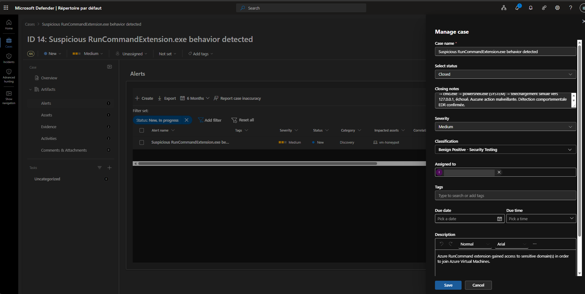

Détail de l'enquête et de la classification : [`enquete-et-classification.md`](enquete-et-classification.md).

## 3. Accès Just-in-Time (JIT)
Le lab 1 a montré le danger d'un RDP ouvert en permanence (4 509 tentatives de force brute). La bonne pratique : **port fermé par défaut, ouvert à la demande**. JIT (inclus dans Defender for Servers) fait exactement ça.

J'ai configuré JIT sur le port **3389, TCP, 1 heure, par demande** (moindre privilège). JIT crée une règle NSG **Deny** permanente ; lors d'une demande, il ajoute une règle **Allow** temporaire pour **mon IP seulement**, priorité plus haute, retirée automatiquement à l'expiration.

| JIT activé | Configuration (3389 / TCP / 1 h) |
|---|---|
| 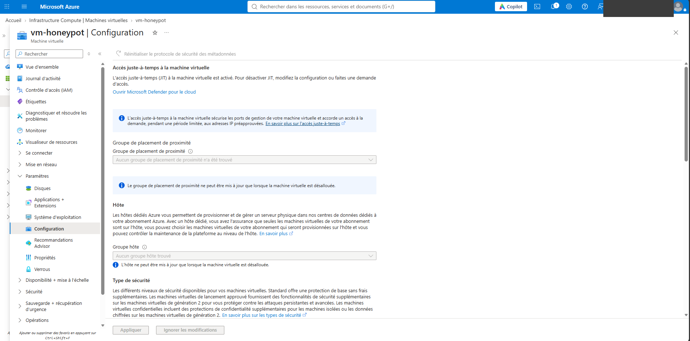 | 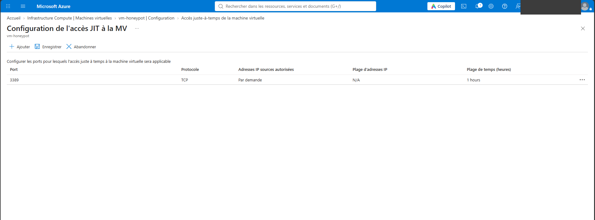 |

| Au repos : règle Deny | Après demande : règle Allow (mon IP, 1 h) |
|---|---|
| 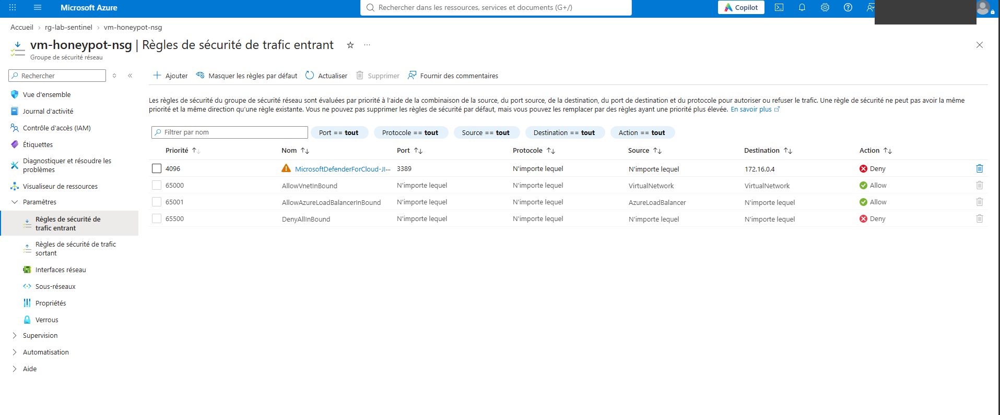 | 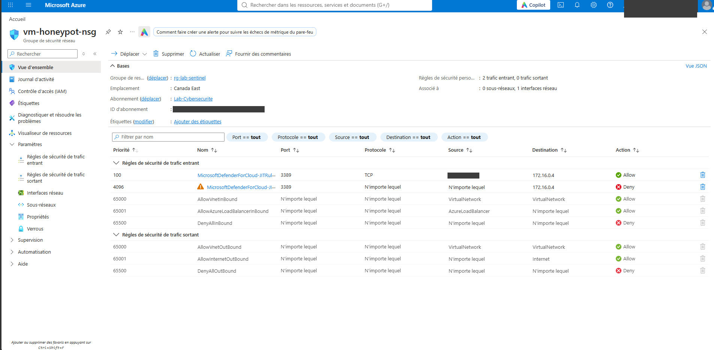 |

Contraste avec le lab 1 : **port ouvert à tout Internet → 4 509 tentatives** ; **JIT → port fermé, ouvert 1 h pour une seule IP**. C'est aussi la **première connexion réussie** du pot de miel (4624, LogonType 10), le pendant positif des échecs du lab 1.

## 4. Simulation d'attaque, chasse KQL et règle personnalisée
Connecté en RDP, j'ai lancé une série de **commandes de reconnaissance** (tactique MITRE **Discovery**) : `whoami`, `systeminfo`, `net user`, `net localgroup`, `ipconfig`, `netstat`, `tasklist`.

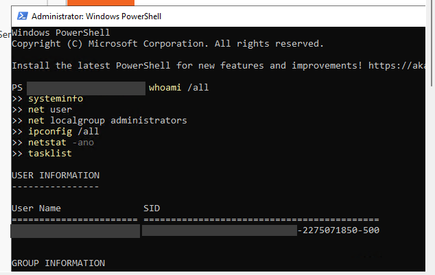

Ces commandes génèrent de la télémétrie mais **pas d'alerte** (trop courantes). J'ai donc chassé en **KQL** sur la table `DeviceProcessEvents`, puis écrit une **règle de détection personnalisée** qui repère une **rafale** d'au moins 4 commandes de découverte distinctes en 10 minutes.

| Chasse KQL | Requête prête pour la règle (Timestamp + ReportId) |
|---|---|
| 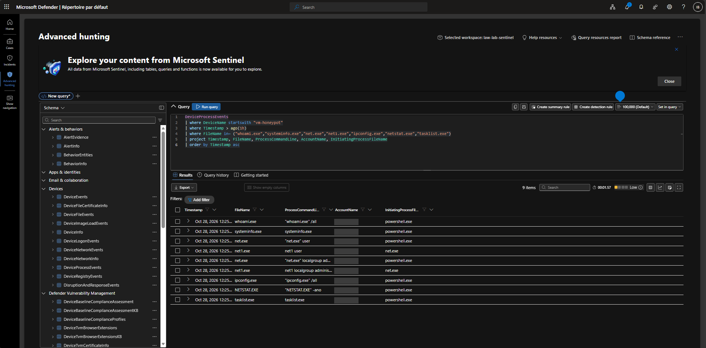 | 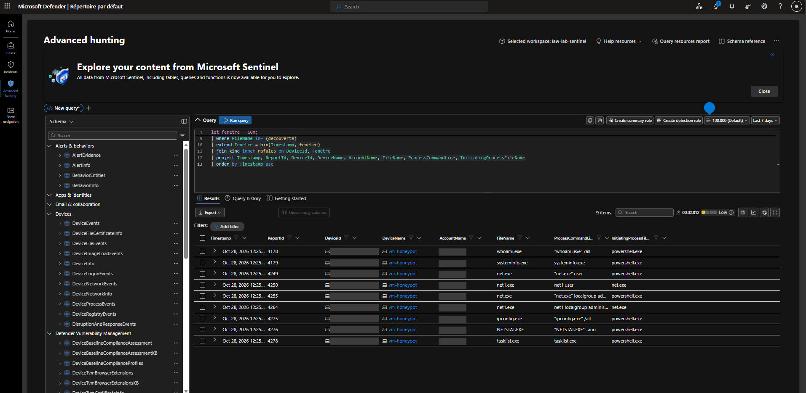 |

Un piège appris : une règle de détection a besoin des colonnes **`Timestamp` et `ReportId`** ; `summarize` les supprime, donc je garde le comptage dans un `let` puis je reviens aux événements avec un `join`. Mappage d'entités sur **Device**.

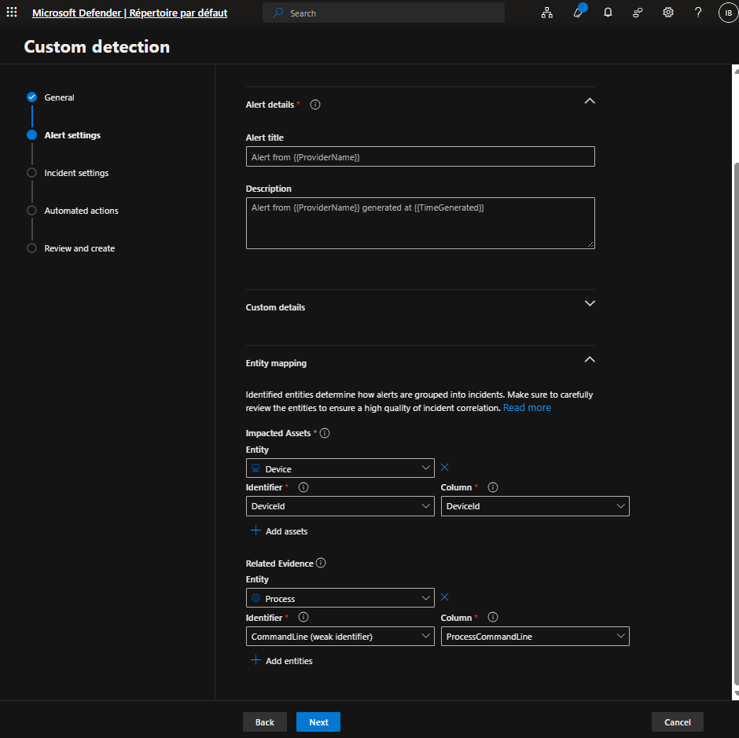

Résultat : la règle a généré **automatiquement un cas** regroupant les 9 événements de ma reconnaissance. La boucle complète d'un ingénieur de détection : **simuler → chasser → écrire la règle → la voir détecter**.

| Cas généré par ma règle | Tous les cas traités (labs 1-4) |
|---|---|
| 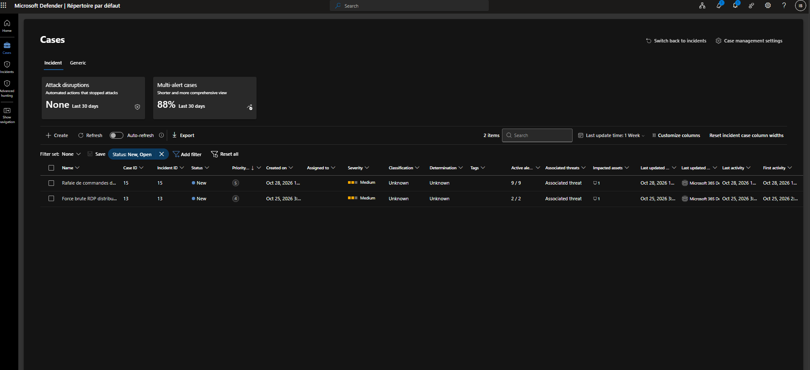 | 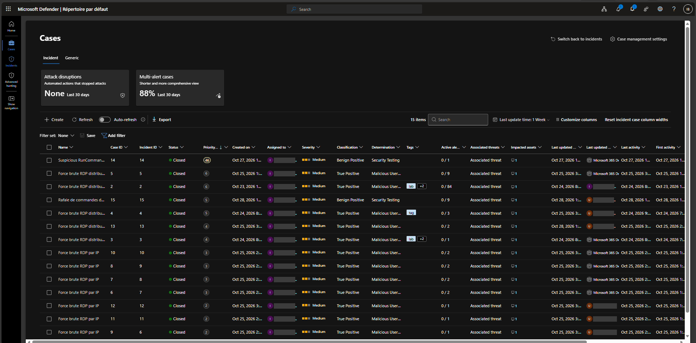 |

Requête KQL complète et logique de la règle : [`detection-personnalisee.md`](detection-personnalisee.md) · requêtes brutes : [`requetes/`](requetes/).

## 5. Vulnérabilités (MDVM)
Une fois la VM active quelques heures, l'évaluation des vulnérabilités a trouvé **22 CVE**. Toutes visent **un seul composant : OpenSSL 3.6.3.0**.

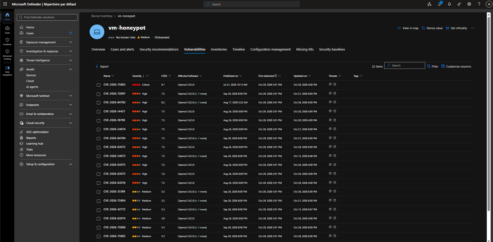

**La leçon clé :** ce ne sont pas 22 problèmes, c'est **un** composant obsolète. Une seule recommandation, « Update vulnerable OpenSSL libraries », résout les 22. On priorise par **impact**, pas par nombre.

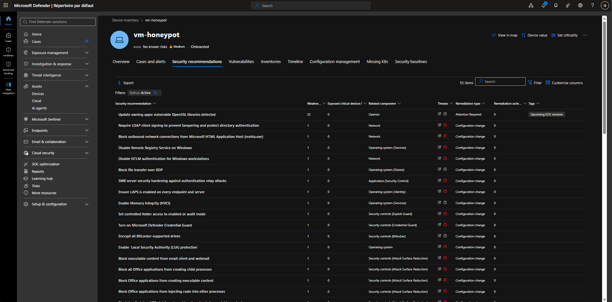

Autre distinction importante : **détecter ≠ corriger.** Activer le scanner (ce lab) = détecter. Mettre à jour OpenSSL = corriger (action séparée, non faite ici car la VM sera supprimée). Les CVE (Vulnerability Management) et les stratégies de conformité (Azure Policy, lab 3) sont deux systèmes distincts.

## 6. Réponse : isolation de l'appareil
J'ai exercé le cycle de réponse EDR : **isoler** l'appareil (couper tout le réseau sauf la connexion à Defender), puis le **relâcher**. Chaque action est tracée dans l'**Action center** — la piste d'audit (qui, quoi, quand).

| Isolation soumise | Libération |
|---|---|
| 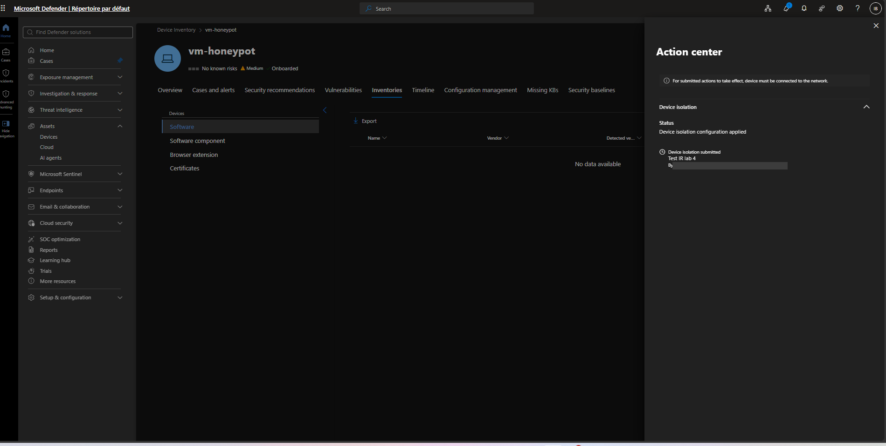 | 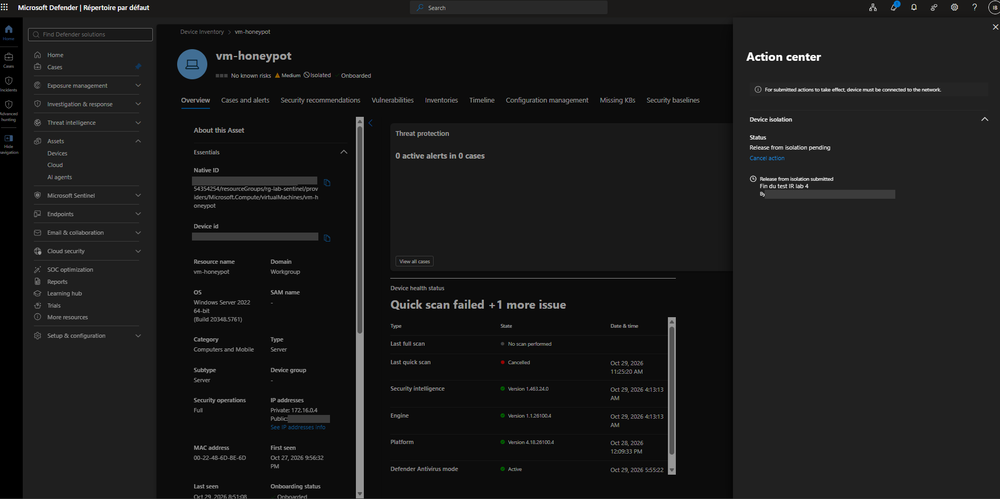 |

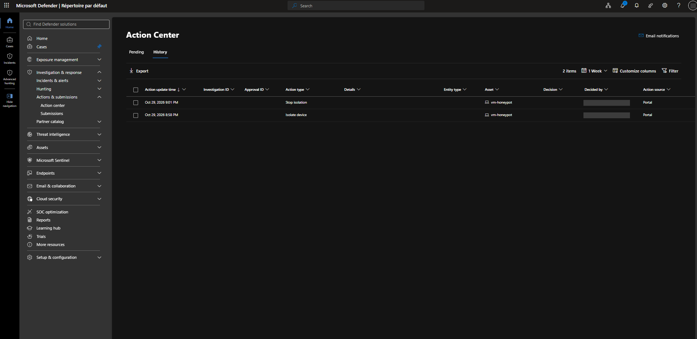

**Quand isoler ?** Seulement si l'hôte est **confirmé compromis**, après analyse, selon le playbook et avec l'autorisation. Une force brute sans connexion réussie (lab 1) ne s'isole pas : on bloque la source et on durcit. Isoler un poste sain perturbe un utilisateur pour rien. Détails sur la décision : [`reponse-et-isolation.md`](reponse-et-isolation.md).

## Difficultés rencontrées et solutions
| Difficulté | Cause | Solution |
|---|---|---|
| Vulnérabilités (MDVM) vides pendant des heures | Premier inventaire long ; la VM doit être **allumée** pour que l'agent collecte | Patience ; les données persistent ensuite même VM éteinte |
| `DeviceTvmSoftwareInventory` renvoie une erreur en KQL | Module de vulnérabilités pas encore provisionné | Attendre la fin de l'activation ; non bloquant |
| Règle de détection refusée (ReportId manquant) | `summarize` supprime `Timestamp`/`ReportId` | Comptage dans un `let`, puis `join` pour revenir aux événements |
| Fréquence > lookback dans la règle | Fréquence 3 h, lookback 1 h | Fréquence ramenée à « toutes les heures » |
| Alerte « RunCommandExtension » inattendue | Defender a détecté l'outil (Run Command) lançant le PowerShell caché | Classée Benign Positive ; bon exemple du risque Run Command du lab 3 |

## Ce que j'ai appris
- **EDR / XDR / SIEM** : l'EDR protège les terminaux, l'XDR corrèle plusieurs sources, le SIEM centralise tout.
- **Defender for Servers** est un forfait qui inclut l'EDR (MDE) plus des fonctions cloud.
- La **télémétrie n'est pas une alerte** : l'EDR enregistre tout, l'alerte vient d'une règle.
- Écrire une **règle de détection** sur mesure en KQL, en gérant `Timestamp`/`ReportId`.
- **22 CVE = 1 correction** : on priorise par impact ; **détecter ≠ corriger**.
- **JIT** ferme le port par défaut et ne l'ouvre qu'à la demande, pour une IP, un temps limité.
- La réponse (**isolation**) se décide après analyse : *ciblé* ou *compromis* ?, et se trace dans l'Action center.

## Nettoyage
- La VM est **arrêtée (libérée)** entre les séances ; l'appareil a été **libéré** de l'isolation avant l'arrêt.
- Le **plan Defender for Servers sera désactivé** avant la fin de l'essai, et tout l'environnement (`rg-lab-sentinel`) supprimé au plus tard le **20/11/2026**.

## Avertissement
Laboratoire personnel réalisé dans mon propre abonnement Azure, à des fins d'apprentissage. Les identifiants d'abonnement et de locataire, adresses IP, adresses courriel et nom d'utilisateur de la VM ont été masqués dans les captures.
